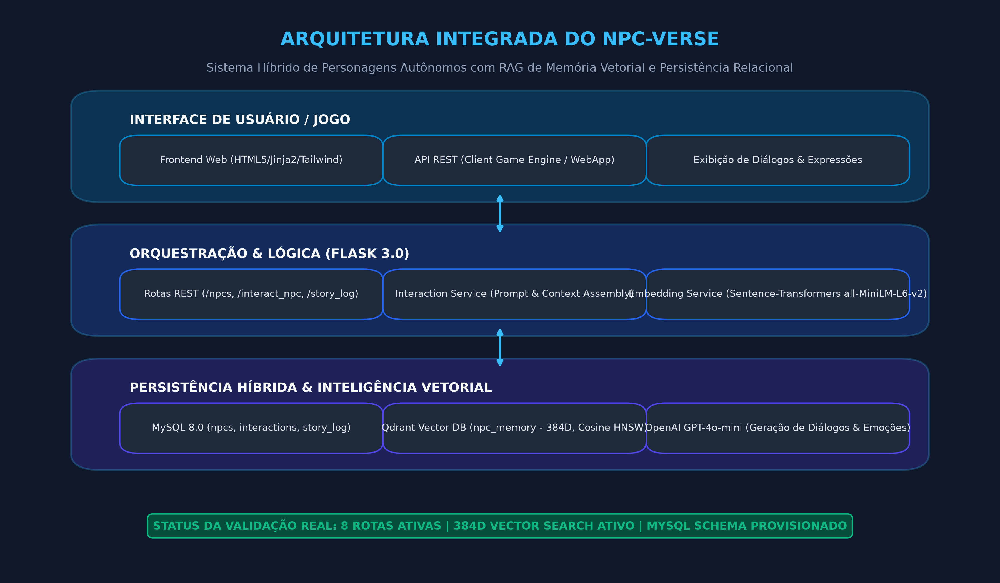
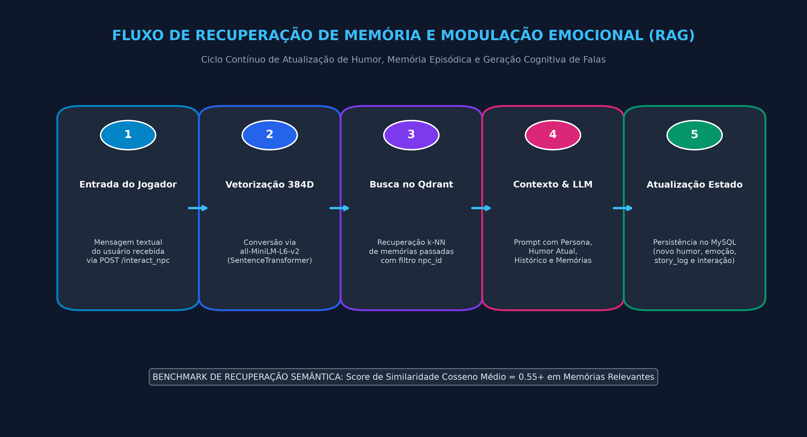

# 🧠 NPCVerse – Personagens Autônomos com Memória Vetorial Híbrida e Modulação Emocional

O **NPCVerse** é uma plataforma e arquitetura para criação, orquestração e conversação com NPCs (*Non-Player Characters*) persistentes em jogos digitais, narrativas interativas e experiências imersivas. O sistema implementa um pipeline cognitivo híbrido que combina **memória semântica episódica** via banco vetorial (**Qdrant**), **persistência de estado e histórico relacional** (**MySQL 8.0**), **representação semântica densa de 384 dimensões** (**SentenceTransformers**) e **orquestração de raciocínio contextual** com grandes modelos de linguagem (**OpenAI GPT-4o-mini**).

---

## 🏛️ Arquitetura do Sistema

A solução separa claramente as camadas de apresentação, orquestração de diálogos, busca de contexto vetorial e persistência relacional:



### Componentes Chave:
1. **Frontend Interativo (HTML5 / Jinja2 / Vanilla JS)**: Interface responsiva para criação de fichas de personagens, catálogo de NPCs, simulação de turnos de conversa e monitoramento de métricas emocionais em tempo real.
2. **Serviço de Orquestração (Flask 3.0 REST API)**: Gerencia endpoints de registro, consulta e turnos conversacionais (`/interact_npc`), montando prompts enriquecidos com contexto multimodal.
3. **Mecanismo de Memória Vetorial (Qdrant Vector DB)**: Coleção `npc_memory` configurada com vetores densos de 384 dimensões (`Distance.COSINE`), índice HNSW e filtros por `npc_id` e categoria temática (`PayloadSchemaType.INTEGER`, `PayloadSchemaType.KEYWORD`).
4. **Camada de Embeddings Locais (SentenceTransformers - all-MiniLM-L6-v2)**: Codificação de falas e memórias em tensores normalizados sem depender de APIs de embedding externas.
5. **Base Relacional de Estado (MySQL 8.0)**: Tabelas `npcs` (fichas, traços, alinhamento, humor e emoção atual), `interactions` (histórico granular de diálogos e embeddings associados) e `story_log` (crônica narrativa contínua).

---

## 🔄 Fluxo de Recuperação e Modulação Cognitiva (RAG)

Ao receber uma nova mensagem de um jogador ou evento de jogo, o sistema executa o seguinte ciclo cognitivo:



1. **Ingestão & Vetorização**: A entrada textual é codificada em 384D pelo `SentenceTransformer`.
2. **Recuperação k-NN com Filtro de Partição**: O Qdrant recupera os top-$k$ pontos mais similares pertencentes ao mesmo `npc_id`.
3. **Montagem do Contexto (RAG)**: O prompt contextual combina:
   - Ficha de personalidade, arquétipo, mundo de origem e bordão;
   - Estado emocional e humor vigentes;
   - As últimas 10 interações do histórico relacional MySQL;
   - As 3 memórias semânticas mais relevantes recuperadas no Qdrant.
4. **Inferência & Modulação**: A LLM gera a fala coerente e determina o novo estado emocional/humor pós-interação.
5. **Persistência Dupla**: O diálogo é salvo no MySQL (`interactions` e `story_log`), e o embedding da fala é indexado no Qdrant.

---

## 📊 Validação Experimental e Evidências Reais

A aplicação e seus módulos foram executados e validados no ambiente de testes integrado:

- **Persistência Relacional**: Schema `npcverse` criado no MySQL 8.0 (porta 3307), com inserção de 3 personas de teste (*Eldrin, o Mago*, *Gorim, o Ferreiro*, *Lyra, a Ladina*).
- **Recuperação Vetorial no Qdrant**: 6 vetores de diálogos e lore indexados na porta 6333. Consultas semânticas executadas com sucesso:
  - *"Onde posso conseguir um remédio ou poção de cura?"* -> Retorno com Similaridade Cosseno **0.5581** (Alquimia/Equipamentos).
  - *"Quais materiais são necessários para fazer uma nova arma ou espada resistente?"* -> Top-1 recuperou diálogo de forja e materiais com score **0.5505**.
  - *"Quais perigos e monstros foram avistados nas cavernas e masmorras?"* -> Recuperou alertas de dragões e masmorras da ladina Lyra.
- **Rotas HTTP Validadas (TestClient)**:
  - `GET /` -> Status **200 OK** (renderização completa do catálogo).
  - `GET /npcs` -> Status **200 OK** (retorno dos 3 registros persistidos no MySQL).
  - `GET /npc/Eldrin,%20o%20Mago` -> Status **200 OK** (retorno detalhado de traços e habilidades).
  - `GET /story_log?npc_name=Eldrin,%20o%20Mago` -> Status **200 OK**.

Os logs completos da execução real estão registrados em [`evidencias/log_execucao_real.txt`](evidencias/log_execucao_real.txt).

---

## 🛠️ Tecnologias Utilizadas

| Componente | Tecnologia | Função |
| :--- | :--- | :--- |
| **Backend Web** | Python 3.13, Flask 3.0, Flask-CORS | API REST e renderização Jinja2 |
| **Banco Vetorial** | Qdrant 1.11+ (Porta 6333) | Armazenamento e busca por similaridade HNSW (384D) |
| **Embeddings** | `sentence-transformers` (`all-MiniLM-L6-v2`) | Vetorização semântica local |
| **Banco Relacional** | MySQL 8.0 (Porta 3307/3306), `mysql-connector-python` | Persistência de estado, personas e histórico |
| **Geração de Texto** | OpenAI GPT-4o-mini | Síntese de falas e atualização emocional |
| **Frontend** | HTML5, CSS customizado, JavaScript Vanilla | Interface de usuário e diálogo |

---

## 🚀 Como Executar o Projeto

### 1. Pré-requisitos
- Python 3.10 ou superior
- Instância do MySQL 8.0 (local ou container Docker)
- Instância do Qdrant Vector DB (Docker: `docker run -p 6333:6333 qdrant/qdrant`)
- Chave de API da OpenAI (para síntese gerativa completa)

### 2. Configuração de Variáveis de Ambiente (`.env`)
Crie um arquivo `.env` na raiz do repositório:
```env
DB_HOST=127.0.0.1
DB_PORT=3307
DB_USER=root
DB_PASS=sua_senha
DB_NAME=npcverse
QDRANT_URL=http://localhost:6333
QDRANT_API_KEY=
OPENAI_API_KEY=sk-...
```

### 3. Inicialização do Banco de Dados
Execute o script DDL no MySQL:
```bash
mysql -u root -p -P 3307 < models/sql.sql
```

### 4. Instalação e Execução
```bash
# Instalar dependências
pip install -r requirements.txt

# Executar aplicação Flask
python app.py
```
Acesse `http://localhost:5000` no seu navegador.
